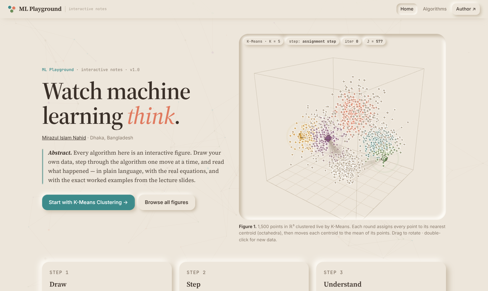
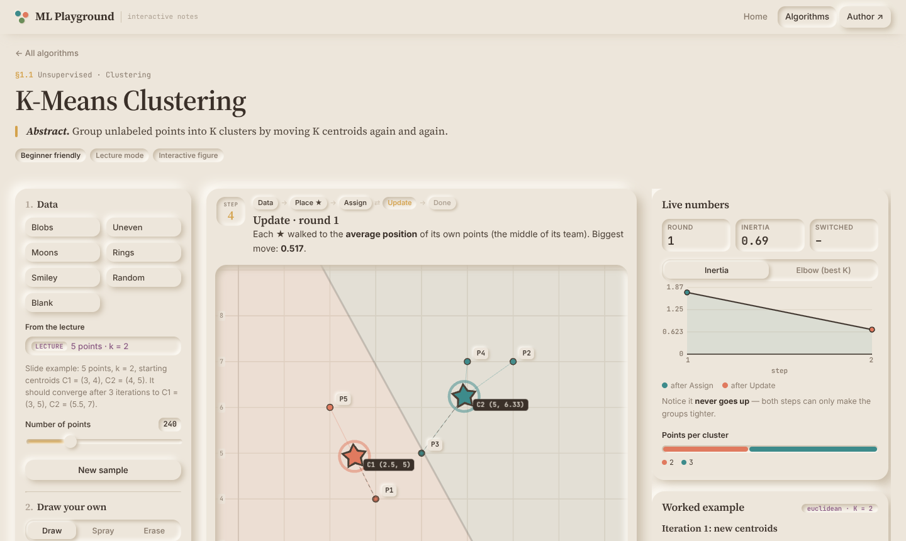
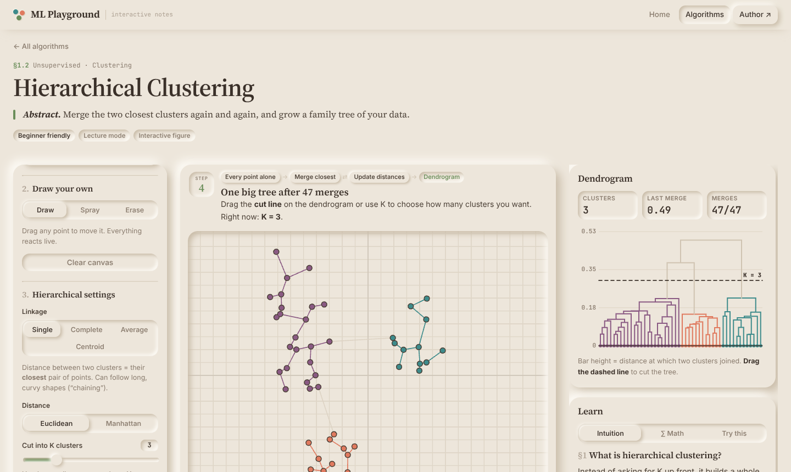
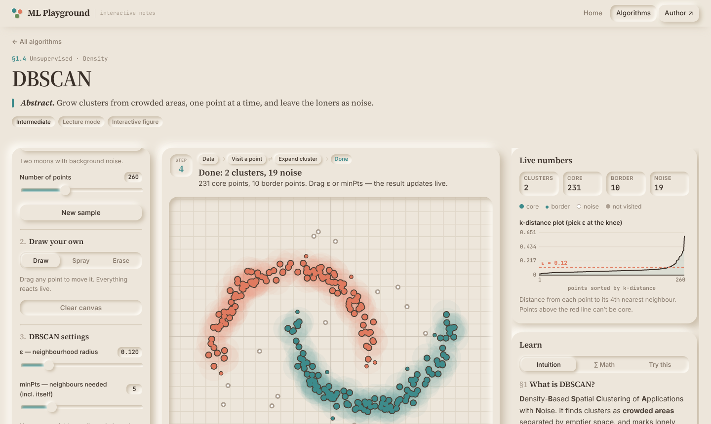
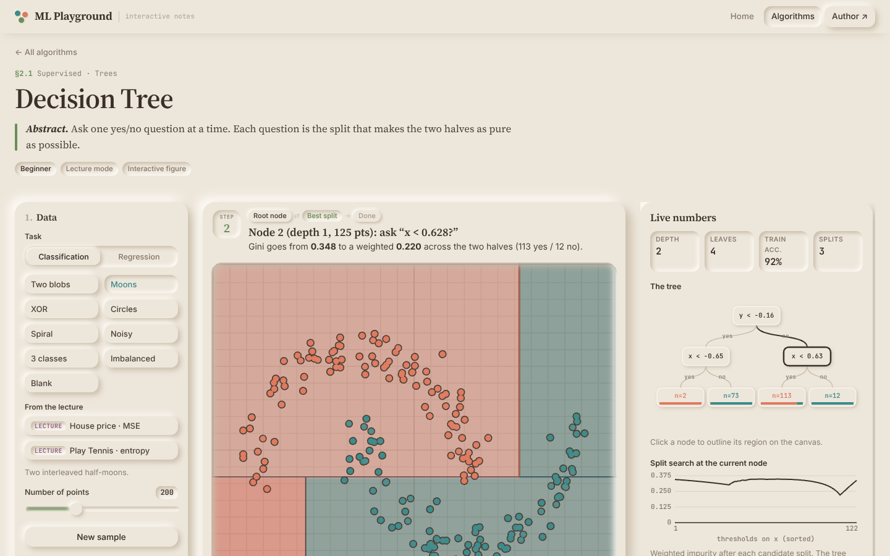
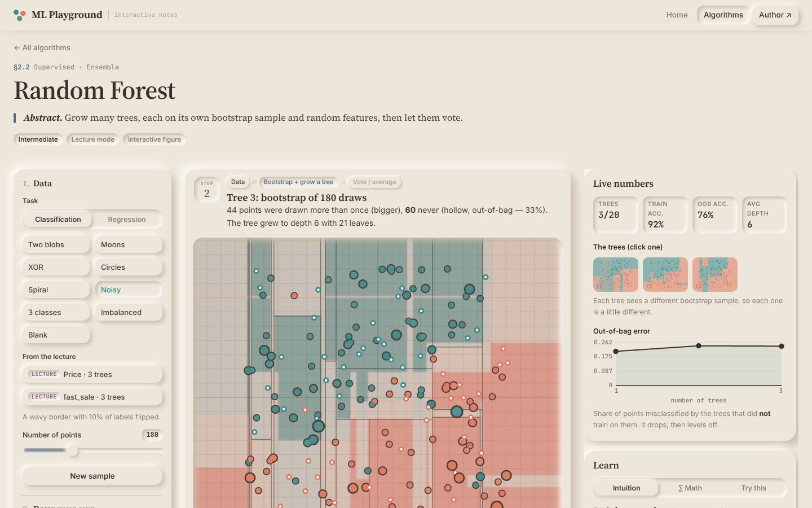
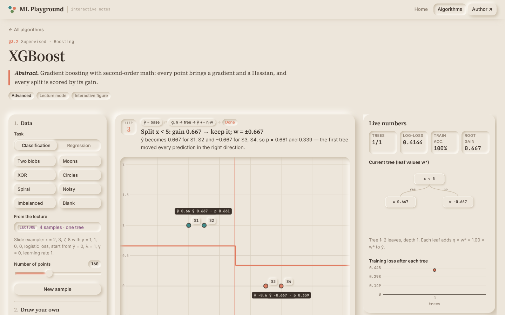

<div align="center">

# ML Playground

### *Interactive notes on machine learning*

Every algorithm is an interactive figure. Draw your own data, step through the algorithm one move at a time, and read what happened: in plain language, with the real equations, and with the exact worked examples from the lecture slides.

[**Live site → ml.mirazulislamnahid.com**](https://ml.mirazulislamnahid.com)


[](https://github.com/TheRealNightmare/ML-Playground/actions/workflows/build.yml)



</div>

---

## Contents

- [Why](#why)
- [Playgrounds](#playgrounds)
- [Lecture mode](#lecture-mode)
- [Design](#design)
- [Getting started](#getting-started)
- [Project structure](#project-structure)
- [Adding an algorithm](#adding-an-algorithm)
- [Deployment](#deployment)
- [Roadmap](#roadmap)

---

## Why

Most explanations of ML algorithms are either a wall of equations or a GIF you can't touch. ML Playground sits in between: each algorithm is a small lab you can **poke**. Add points where you want, drag centroids around, slow it down, step through it, and read what just happened.

It is written for two audiences at once:

- **Beginners** get an analogy-first *Intuition* tab and a narrator that explains every step in plain English.
- **University students** get a *Math* tab with numbered equations and pseudocode that highlights the line currently running, plus *Worked example* tables that rebuild the lecture slides step by step.

## Playgrounds

| § | Playground | Type | Status |
|---|---|---|---|
| 1.1 | [K-Means Clustering](https://ml.mirazulislamnahid.com/#/kmeans) | Unsupervised · Clustering | ✅ Live |
| 1.2 | [Hierarchical Clustering](https://ml.mirazulislamnahid.com/#/hierarchical) | Unsupervised · Clustering | ✅ Live |
| 1.3 | [Fuzzy C-Means](https://ml.mirazulislamnahid.com/#/fcm) | Unsupervised · Soft clustering | ✅ Live |
| 1.4 | [DBSCAN](https://ml.mirazulislamnahid.com/#/dbscan) | Unsupervised · Density | ✅ Live |
| 1.5 | [HDBSCAN](https://ml.mirazulislamnahid.com/#/hdbscan) | Unsupervised · Density | ✅ Live |
| 2.1 | [Decision Tree](https://ml.mirazulislamnahid.com/#/decision-tree) | Supervised · Trees | ✅ Live |
| 2.2 | [Random Forest](https://ml.mirazulislamnahid.com/#/random-forest) | Supervised · Ensemble | ✅ Live |
| 2.3 | [Ensemble Learning](https://ml.mirazulislamnahid.com/#/ensemble) | Concepts · Bias & variance | ✅ Live |
| 3.1 | [AdaBoost](https://ml.mirazulislamnahid.com/#/adaboost) | Supervised · Boosting | ✅ Live |
| 3.2 | [XGBoost](https://ml.mirazulislamnahid.com/#/xgboost) | Supervised · Boosting | ✅ Live |
| 3.3 | [CatBoost](https://ml.mirazulislamnahid.com/#/catboost) | Supervised · Boosting | ✅ Live |
| 4.1 | [Cross-Validation](https://ml.mirazulislamnahid.com/#/cross-validation) | Concepts · Evaluation | ✅ Live |

<table>
<tr>
<td width="50%"><br><sub><b>K-Means</b> — the 5-point lecture example, mid-run, with the iteration table on the right.</sub></td>
<td width="50%"><br><sub><b>Hierarchical</b> — single linkage draws the spanning tree; drag the dashed line to cut the dendrogram.</sub></td>
</tr>
<tr>
<td colspan="2"><br><sub><b>DBSCAN</b> — two moons found, noise left hollow, and a k-distance plot to choose ε.</sub></td>
</tr>
<tr>
<td width="50%"><br><sub><b>Decision Tree</b> — grown one split at a time; the tree diagram and the split-search curve update live.</sub></td>
<td width="50%"><br><sub><b>Random Forest</b> — bigger dots were drawn twice, hollow ones are out-of-bag; thumbnails show every tree.</sub></td>
</tr>
<tr>
<td colspan="2"><br><sub><b>XGBoost</b> — the four-sample slide example: split x &lt; 5, gain 0.667, leaf weights ±0.667, probabilities 0.661 / 0.339.</sub></td>
</tr>
</table>

### What every playground has

- **Draw your own data.** Click to add points, drag to move them, spray whole clouds, erase. Everything re-runs live. On the supervised pages you pick the class of each new point, or switch to regression and draw (x, y) points.
- **Presets.** Blobs, moons, rings, uneven groups, noisy data, different densities, a smiley — and for supervised learning: XOR, circles, spiral, noisy borders, three classes, imbalanced classes, and sine / steps / line / parabola for regression.
- **Step-by-step playback.** Play, pause, single step, reset and speed, with a narrator and a step tracker for the current phase.
- **Live numbers.** Inertia, merge heights, memberships, core/border/noise counts, accuracies, losses, ε and α, out-of-bag error, and charts such as the elbow, k-distance, split-search and per-fold plots.
- **Learn tabs.** *Intuition* (analogies), *Math* (numbered equations, pseudocode), *Try this* (one-click challenges that show where the algorithm shines and where it fails).

### Per algorithm

| Playground | Highlights |
|---|---|
| **K-Means** | Rippling assignments, centroid footprints, Voronoi regions in a shader, K-Means++ / random / farthest-pair starts, Euclidean or Manhattan distance, elbow chart, bad-start challenge. |
| **Hierarchical** | Single, complete, average and centroid linkage; Euclidean or Manhattan; a growing dendrogram with a draggable cut line; distance-table exercise from the slides. |
| **Fuzzy C-Means** | Point colors blend by membership; a soft membership field fills the background; fuzziness *m* slider; hover any point for its membership bars. |
| **DBSCAN** | Visits one point per step with its ε-circle and neighbours; core / border / noise; k-distance plot; ε and minPts update the result live. |
| **HDBSCAN** | Core distances → mutual reachability → animated minimum spanning tree → condensed tree with stability. Switch between real HDBSCAN and the slides' threshold cut. |
| **Decision Tree** | Classification (Gini / entropy) and regression (MSE) trees grown one split at a time; decision regions or a step curve; tree diagram (click a node to outline its region); split-search curve; ID3 on the Play Tennis table. |
| **Random Forest** | Bootstrap samples shown on the canvas (bigger = drawn twice, hollow = out-of-bag), random feature per split, a thumbnail per tree, vote-share regions, out-of-bag error curve. |
| **Ensemble Learning** | Four views: bias–variance (refit on fresh samples, dartboard, error vs depth), bagging (test accuracy vs one deep tree), gradient boosting with residual sticks, and stacking (tree + logistic + k-NN with an out-of-fold meta-model). |
| **AdaBoost** | Weighted stumps; points grow with their weight; ε, α and the re-weighting shown per round; thumbnails of each stump; ensemble error curve. |
| **XGBoost** | Gradients and Hessians per point (size = \|g\|), split search with G/H/gain tables, live λ, γ, η and depth sliders, tree diagram with leaf weights w*. Logistic loss for classes, squared error for regression. |
| **CatBoost** | Ordered target encoding step by step (customers in lanes, lines to the earlier rows it uses) vs. the leaky version; boosting with oblivious (symmetric) trees whose questions cut the whole plane. |
| **Cross-Validation** | Holdout, K-fold, LOOCV and stratified folds on k-NN or a tree; fold rings on the canvas, per-fold scores with mean ± std, fold composition table, and a 40× repeated-holdout histogram. |

### Keyboard shortcuts

| Key | Action |
|---|---|
| `Space` | Play / pause |
| `→` | One step |
| `R` | Reset (keeps your points) |
| `↑ ↑ ↓ ↓ ← → ← → B A` | Appendix A |

## Lecture mode

Each page has **From the lecture** buttons that load the exact worked examples from the course slides (same points, same settings), and a **Worked example** card that rebuilds the slide tables live as you step: distance matrices, centroid formulas, membership tables, ε-neighbourhoods, core distances and spanning-tree edges. The axes switch to the slides' units so every number matches.

The maths lives in pure `algo.js` files and was checked in Node against the slides:

| Example | Matches |
|---|---|
| K-Means, 5 points, k = 2 | Converges after 3 iterations to C1 = (3, 5), C2 = (5.5, 7); new point (2, 7) → Cluster 1. |
| Hierarchical, 5 points, Manhattan + centroid | Merge heights 1, 2, 5.5, 10.75. |
| Hierarchical, A–E distance table, single link | Merges at 2, 3, 4, 5. |
| Fuzzy C-Means, 1D x = 1, 2, 7, 8 | c₁ ≈ 2.34, c₂ ≈ 6.44, u₁₁ ≈ 0.94. |
| Fuzzy C-Means, 2D three points | c₁ ≈ (1.93, 2.35), c₂ ≈ (4.34, 3.50), u₁₁ ≈ 0.93. |
| DBSCAN, A–J, ε = 1.5, minPts = 3 | Two clusters, H is a border point, I and J are noise. |
| HDBSCAN, A–F, k = 2 | Core distances 1.41, 1, 1.41, 7.07, 7.21, 74.95; MST A–B, B–C, C–D, D–E, D–F; cut at ε = 7 → (A, B, C). |
| Decision tree, 6 houses, MSE | Best split size < 1600, weighted MSE 541.7 < 600 → leaves 180 / 275. |
| ID3, Play Tennis | Gains: Outlook 0.247, Temperature 0.029, Humidity 0.152, Wind 0.048; Sunny → Humidity, Rain → Wind. |
| Random forest, 5 houses, 3 bootstraps | Regression: both 1280 and 1460 → 214.44. Classification: 1280 → Yes, 460 → No. |
| Ensemble learning | Bagging subsets [3, 7, 7, 1, 12], [5, 5, 10, 3, 9], [8, 2, 2, 12, 6] → Good; boosting A–F; stacking → Good. |
| AdaBoost, hours 2, 4, 6, 8 | α = 0.549, 0.805, 1.099; weights [.167, .167, .5, .167] → [.10, .50, .30, .10]; new sample 0.255 → +1. |
| XGBoost, x = 2, 3, 7, 8 | g = ±0.5, h = 0.25; split x < 5 with gain 0.667; w = ±0.667; p = 0.661 / 0.339. |
| CatBoost, 5 customers | CTRs [0.60, 0.60, 0.30, 0.80, 0.60]; Age < 28 → 0.40 / −0.267; predictions 0.80 / 0.4667. |
| Cross-validation | 15 points K = 3 (1–5, 6–10, 11–15); LOOCV on A–E; stratified 9 : 3 → 3 : 1 in every fold. |

Where a slide step is inconsistent, the card shows the correct value with a short 📌 note. Examples:

- the final centroid in the hierarchical example, and one mutual-reachability value in HDBSCAN;
- four of the candidate rows in the decision-tree MSE table (the winning split is unchanged);
- random forest: tree 1's right mean (380, not 350), tree 3's best split (1575, not 1400), the resulting averages, and the classification vote for size 460;
- AdaBoost: “Sample 2” in step 5 should be sample 3, and learner 3's predictions can't come from a single stump;
- CatBoost: the final prediction adds both leaves, and applies a sigmoid to a probability.

## Design

A soft **neumorphic** interface in warm sand, laid out like a research paper.

- **Surfaces** are either raised from the page or pressed into it. Buttons press in when clicked, and the simulation canvas is a pressed-in well.
- **Colors**: sand base `#EDE6DB` with earthy categorical colors (terracotta, teal, mustard, sage, plum, slate, rust, olive) that stay distinct on the background.
- **Type**: Source Serif 4 for headings, Inter for text, JetBrains Mono for numbers.
- **Paper touches**: § section numbers, *Abstract* lines, live **Figure** captions, numbered equations and notes, booktabs-style tables.
- **3D (three.js)** on the home page only, so lab pages stay focused:
  - **Figure 1**, a 1,500-point cloud that runs K-Means on itself in a loop (drag to rotate, double-click for new data);
  - a faint drifting neighbour graph in the background;
  - a small 3D figure on every card that animates on hover (all drawn by one shared WebGL renderer).
- Respects *reduce motion*, and pauses 3D when it's off-screen.

## Getting started

Requires **Node.js 18+** (developed on Node 22).

```bash
git clone https://github.com/TheRealNightmare/ML-Playground.git
cd ML-Playground
npm install
npm run dev        # http://localhost:5173
```

| Command | What it does |
|---|---|
| `npm run dev` | Dev server with hot reload |
| `npm run build` | Static build into `dist/` |
| `npm run preview` | Serve the built site locally |

## Project structure

```
ML-Playground/
├── index.html
├── public/favicon.svg
├── src/
│   ├── main.js                # hash router (#/kmeans), header, fonts
│   ├── home.js                # home page: hero figure, sections, cards
│   ├── konami.js              # Appendix A
│   ├── styles.css             # neumorphic warm-sand theme
│   ├── three/                 # 3D for the home page
│   │   ├── hero3d.js          # Figure 1: self-clustering 3D point cloud
│   │   ├── bgfield.js         # faint background neighbour graph
│   │   ├── cardart.js         # per-card 3D previews (one shared renderer)
│   │   └── points3d.js        # shaded round points, palette, figure box
│   ├── core/                  # shared by every playground
│   │   ├── pointlab.js        # scaffold: tools, datasets, lecture mode, narrator, playback
│   │   ├── suplab.js          # supervised scaffold: task switch, class picker, decision field, curves
│   │   ├── trees.js           # CART engine (classification, regression, XGBoost gradients), bootstrap
│   │   ├── models.js          # logistic regression and k-NN (stacking, cross-validation)
│   │   ├── field.js           # decision-region texture painted from any model
│   │   ├── treeview.js        # tree diagram
│   │   ├── thumbs.js          # per-model thumbnails (forests, boosting rounds)
│   │   ├── supdata.js         # labelled classification and regression datasets
│   │   ├── lab.js             # page layout: § title, abstract, figure + caption
│   │   ├── stage.js           # orthographic 2D three.js stage
│   │   ├── layers.js          # points, stars, region shader, circles, segments, trails
│   │   ├── space.js           # slide units ↔ canvas units
│   │   ├── overlay.js         # point labels and axes in slide units
│   │   ├── worked.js          # worked-example tables and notes
│   │   ├── player.js          # play / pause / step / reset / speed
│   │   ├── chart.js           # small canvas line & bar charts
│   │   ├── datasets.js        # shared 2D datasets
│   │   ├── tex.js             # KaTeX helpers
│   │   ├── ui.js              # sliders, segmented controls, toggles, tabs
│   │   └── theme.js           # one palette for CSS, canvas and 3D
│   └── algorithms/
│       ├── index.js           # registry + sections
│       ├── kmeans/            # <id>.js page · algo.js pure math · content.js text
│       ├── hierarchical/
│       ├── fcm/
│       ├── dbscan/
│       ├── hdbscan/
│       ├── decision-tree/     # also id3.js (Play Tennis)
│       ├── random-forest/
│       ├── ensemble/
│       ├── adaboost/
│       ├── xgboost/
│       ├── catboost/
│       └── cross-validation/
├── Dockerfile                 # node build → nginx serve (multi-arch)
├── nginx.conf                 # caching, gzip, headers, /healthz
├── .github/workflows/build.yml
└── DEPLOY.md                  # step-by-step Dokploy + Cloudflare Tunnel guide
```

No UI framework: plain ES modules, three.js for graphics, KaTeX for equations. Each playground is lazy-loaded.

## Adding an algorithm

1. Create `src/algorithms/<id>/<id>.js` exporting `mount(root)`, which returns an `unmount()` function.
2. For point-based algorithms, start from `createPointLab()`. It gives you the layout, drawing tools, datasets, lecture mode, narrator and playback; you fill in `L.hooks` (`reset`, `step`, `frame`, `labels`, …). For supervised models use `createSupLab()` instead: it adds the classification/regression switch, the class picker, `L.showField(probs)` for decision regions and `L.setCurves([...])` for 1D models.
3. Put the maths in a pure `algo.js` so it can be checked in Node against the slide numbers.
4. Register it in `src/algorithms/index.js`:

```js
{
  id: 'svm', section: 'evaluation',
  title: 'Support Vector Machine',
  category: 'Supervised · Margins', level: 'Intermediate',
  tagline: 'Find the widest street between two classes.',
  accent: '#4F6D8A',
  load: () => import('./svm/svm.js'),
},
```

The home card, its § number and the `#/svm` route appear automatically (add `soon: true` without `load` to show an “In preparation” card instead). Add a 3D preview for the card in `src/three/cardart.js` if you like.

## Deployment

The site is a static build served by nginx in Docker. It runs on a **Raspberry Pi with Dokploy**, behind a **Cloudflare Tunnel**, at **ml.mirazulislamnahid.com**.

**Short version** (full guide with checks and troubleshooting in **[DEPLOY.md](DEPLOY.md)**):

1. Dokploy → **Create Service → Application** → Provider **GitHub** → `TheRealNightmare/ML-Playground`, branch `main`.
2. Build Type **Dockerfile** (`Dockerfile`, context `.`).
3. Domains → Host `ml.mirazulislamnahid.com`, Path `/`, Container Port `80`, **HTTPS off** (Cloudflare handles TLS).
4. **Deploy**, then turn on **Autodeploy**.
5. Check: `curl https://ml.mirazulislamnahid.com/healthz` → `ok`.

Every push to `main` runs the **Build check** workflow (site build + arm64 Docker image smoke test) and triggers a Dokploy redeploy.

Run it anywhere with Docker:

```bash
docker build -t ml-playground .
docker run -d -p 8080:80 --restart unless-stopped ml-playground   # http://localhost:8080
```

## Roadmap

- [x] §1 Clustering: K-Means, Hierarchical, Fuzzy C-Means, DBSCAN, HDBSCAN
- [x] §2 Trees & Ensembles: Decision Tree, Random Forest, Ensemble Learning
- [x] §3 Boosting: AdaBoost, XGBoost, CatBoost
- [x] §4 Model Evaluation: Cross-Validation
- [ ] More to come as the course continues

## Author

**Mirazul Islam Nahid**
[Portfolio](https://mirazulislamnahid.com) · [GitHub](https://github.com/TheRealNightmare) · [Blog](https://therealnightmare.github.io)
