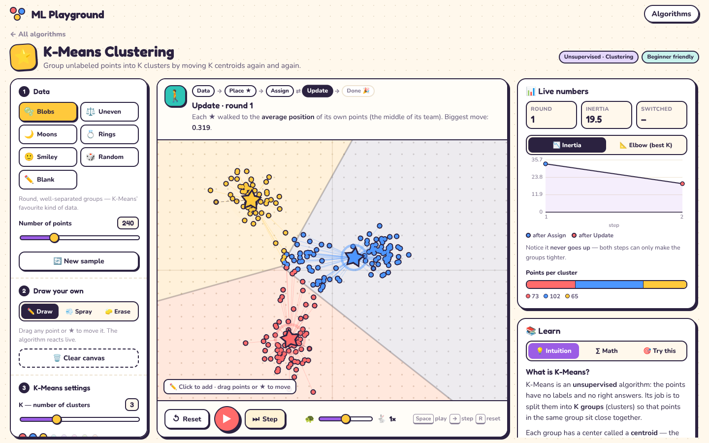

<div align="center">

# 🎈 ML Playground

**Watch machine learning think.**

Interactive, animated simulations of machine learning algorithms, built with three.js.
Draw your own data, press play, and follow every step with plain-English notes and the real math beside it.

[**Live demo → ml.mirazulislamnahid.com**](https://ml.mirazulislamnahid.com)




</div>

---

## ✨ Why this exists

Most explanations of ML algorithms are either a wall of equations or a static GIF. ML Playground sits in between: every algorithm is a small lab you can **poke**. Add points where you want, drag the model's parameters around, slow it down, run it one step at a time, and read what just happened.

It is written for two audiences at once:

- **Total beginners** get an analogy-first **Intuition** tab and a narrator that explains each step in plain English.
- **University students** get a **Math** tab with the objective function, update rules and pseudocode that highlights the line currently running.

## 🧪 Playgrounds

| | Algorithm | Type | Status |
|---|---|---|---|
| ⭐ | [K-Means Clustering](https://ml.mirazulislamnahid.com/#/kmeans) | Unsupervised · Clustering | ✅ Live |
| 🧪 | More algorithms | — | 🚧 Added one at a time |

### ⭐ K-Means Clustering

**See it work**
- Points change color in a ripple spreading out from their nearest centroid (the ★).
- Stars glide to the mean of their cluster and leave dashed footprints behind.
- A GPU shader shades the area each star owns and draws the exact borders between them, which makes it obvious that K-Means borders are always straight lines.
- A narrator and a step tracker (Data → Place ★ → Assign ⇄ Update → Done) explain every move.

**Make your own data**
- ✏️ **Draw**: click to add a point, drag any point to move it.
- 💨 **Spray**: hold and drag to paint whole clouds of points.
- 🧽 **Erase**: hold and drag to wipe points away.
- Drag a ★ at any time and watch every point re-pick its nearest star live.
- Presets: Blobs, Uneven, Moons, Rings, Smiley, Random and Blank.

**Control the algorithm**
- K from 1 to 8.
- Three ways to place the starting stars: **K-Means++**, **random data points** (Forgy), or **anywhere** on the canvas.
- Play, pause, single-step, reset and a speed slider (0.25× to 4×).

**Measure it**
- An **inertia** (WCSS) chart that records every assign and update step, so you can see it never goes up.
- An **elbow chart** for K = 1…8. Click a bar to use that K.
- A bar showing how many points each cluster holds.

**Learn it**
- 💡 **Intuition**: the ice-cream-truck analogy, the four steps, strengths and limits.
- ∑ **Math**: objective, assignment and update rules, why it always converges, K-Means++ probabilities, cost, and the elbow method.
- 🎯 **Try this**: six one-click challenges, such as a bad start that gets stuck in a local minimum and the Moons dataset where K-Means fails.

### ⌨️ Keyboard shortcuts

| Key | Action |
|---|---|
| `Space` | Play / pause |
| `→` | One step |
| `R` | Reset (keeps your points) |

## 🚀 Getting started

Requires **Node.js 18+** (developed on Node 22).

```bash
git clone https://github.com/TheRealNightmare/ML-Playground.git
cd ML-Playground
npm install
npm run dev        # http://localhost:5173
```

| Command | What it does |
|---|---|
| `npm run dev` | Start the dev server with hot reload |
| `npm run build` | Build the static site into `dist/` |
| `npm run preview` | Serve the built site locally |

## 🗂️ Project structure

```
ML-Playground/
├── index.html
├── public/favicon.svg
├── src/
│   ├── main.js              # hash router (#/kmeans), fonts, styles
│   ├── home.js              # landing page + algorithm cards
│   ├── styles.css           # the playful theme
│   ├── core/                # shared by every simulation
│   │   ├── stage.js         # three.js orthographic 2D stage, pointer → world coords
│   │   ├── layers.js        # points, centroid stars, Voronoi region shader, links, trails
│   │   ├── player.js        # play / pause / step / reset / speed + keyboard shortcuts
│   │   ├── chart.js         # tiny canvas line & bar chart
│   │   ├── lab.js           # 3-column lab page layout
│   │   ├── ui.js            # DOM helpers: slider, segmented, toggle, tabs
│   │   └── theme.js         # one color palette for CSS and three.js
│   └── algorithms/
│       ├── index.js         # registry of all playgrounds
│       └── kmeans/
│           ├── kmeans.js    # page: state, animation, interaction, UI
│           ├── algo.js      # pure K-Means math (assign, update, inits, elbow)
│           ├── datasets.js  # preset datasets
│           └── content.js   # narrator lines + Intuition / Math / Try-this tabs
├── Dockerfile               # Node build → nginx serve
└── nginx.conf
```

No UI framework: plain ES modules, three.js for the canvas and KaTeX for equations. Each playground is lazy-loaded, so the home page stays small.

## ➕ Adding a new algorithm

1. Create `src/algorithms/<id>/<id>.js` and export `mount(root)`, which builds the page and returns an `unmount()` cleanup function.
2. Build it from the shared pieces in `src/core/`:
   - `createLab()` for the page layout,
   - `Stage` for the three.js canvas,
   - `Player` for playback controls,
   - `MiniChart` for live metrics,
   - layers such as `PointLayer` and `RegionBackground`.
3. Register it in `src/algorithms/index.js`:

```js
{
  id: 'linreg',
  title: 'Linear Regression',
  emoji: '📈',
  category: 'Supervised · Regression',
  level: 'Beginner',
  tagline: 'Fit a line by rolling downhill on the loss surface.',
  accent: '#4D96FF',
  load: () => import('./linreg/linreg.js'),
},
```

The home page card and the `#/linreg` route appear automatically.

## 🐳 Deployment

The `Dockerfile` builds the site with Node and serves `dist/` with nginx on port **80**. Both base images are multi-arch, so it builds natively on ARM64 boards such as a Raspberry Pi.

```bash
docker build -t ml-playground .
docker run -p 8080:80 ml-playground   # http://localhost:8080
```

`nginx.conf` gzips text assets, caches hashed files under `/assets/` for a year, and always serves a fresh `index.html` so new deploys show up immediately.

### Dokploy + Cloudflare Tunnel

This is how the live site is hosted:

1. In Dokploy, create an **Application** from this GitHub repo.
2. Set **Build Type** to `Dockerfile`.
3. Under **Domains**, add `ml.mirazulislamnahid.com` with container port `80`. Leave HTTPS off in Dokploy, because Cloudflare terminates TLS.
4. In the Cloudflare Tunnel, route the hostname to Dokploy's Traefik service (skip this if a wildcard route already exists).
5. Turn on **Auto Deploy** so every push to `main` redeploys.

## 🗺️ Roadmap

- [x] K-Means clustering
- [ ] More algorithms, added one at a time

## 👤 Author

**Mirazul Islam Nahid**
[Portfolio](https://mirazulislamnahid.com) · [GitHub](https://github.com/TheRealNightmare) · [Blog](https://therealnightmare.github.io)
